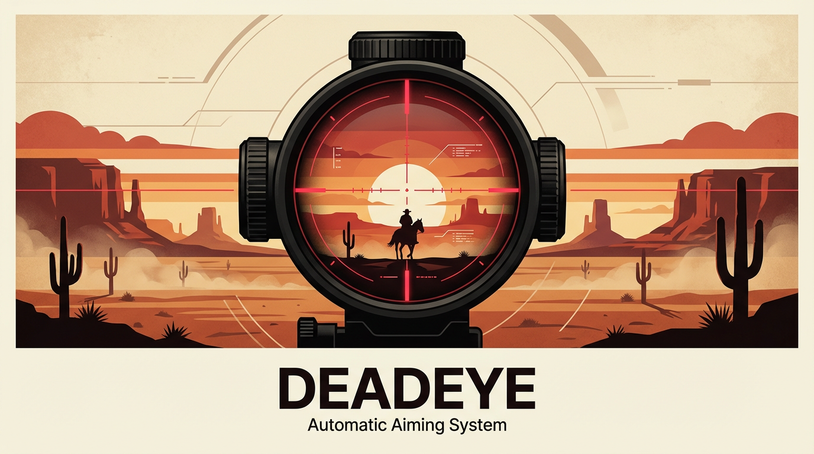
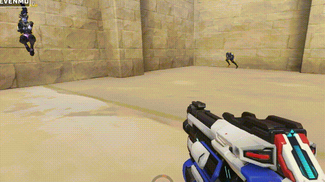

# DeadEye 通用视觉目标定位与追踪系统框架 / DeadEye: Universal Visual Target Localization & Tracking Framework



DeadEye 是一个**通用的视觉目标定位与追踪系统框架**：模块化流水线「输入 → 检测 → 追踪 → 执行」，检测层以可插拔后端覆盖 YOLOv5/v7/v8/v11/v12/26 的完整 CUDA 部署链（ONNX Runtime CUDA EP / TensorRT + CUDA Graph，RTX 5090 实测端到端 789–1200 FPS），追踪层提供 IoU 匈牙利匹配、卡尔曼滤波与可配置的目标生命周期，执行层把定位结果对接到任意下游动作。

作为示例，仓库提供了 FPS 游戏屏幕目标追踪与辅助瞄准的效果演示（通过分析屏幕截图检测并追踪目标，再由模拟操作实现辅助瞄准与自动扳机）。同样的框架我已应用在光学激光控制与监控探头目标追踪中——这些领域的示例程序未随仓库提供，但只需替换或扩展对应模块，即可把 DeadEye 组装到任何"看得见、框得住、要跟随"的任务上。

DeadEye is a **universal visual target localization & tracking framework**: a modular pipeline (*input → detection → tracking → execution*) where the detection layer ships pluggable backends covering the full CUDA deployment chain of YOLOv5/v7/v8/v11/v12/26 (ONNX Runtime CUDA EP / TensorRT + CUDA Graph, measured 789–1200 FPS end-to-end on an RTX 5090), the tracking layer provides IoU-cost Hungarian matching, Kalman filtering and a configurable target lifecycle, and the execution layer connects localization results to arbitrary downstream actions.

As a showcase, the repository includes an FPS screen-tracking & aim-assist demo (detect and track targets from screen captures, then drive simulated aiming/trigger actions). I have also deployed the same framework to optical laser control and surveillance-camera target tracking — those samples are not included, but by swapping or extending the corresponding modules, DeadEye can be assembled onto any task that needs to "see, localize and follow".

## 近期更新（2026）

- **检测与 CUDA 部署重构（2026-10）**：检测模块重构为「统一检测器 + 可插拔推理后端」架构（`deadeye/detection_module/backends/`）：
  - **模型支持**：YOLOv5 / v7 / v8 / v11 / v12 / 26 一套代码覆盖；后处理按输出布局自动解码（v5/v7 含 objectness 头、v8/v11/v12 解码头、v10/v26 端到端免 NMS 头），优先使用 Ultralytics 导出元数据消歧。
  - **推理后端**：`.pt` → Ultralytics（torch）；`.onnx` → ONNX Runtime CUDA EP（IOBinding 稳态零分配，无 GPU 自动回退 CPU）；`.engine` / `.plan` / `.trt` → 原生 TensorRT 10/11 后端（cuda-python + pinned 显存预分配 + 非默认流）。
  - **引擎工具链**：`tools/export_yolo.py`（pt → ONNX/engine）、`tools/convert_fp16.py`（FP16 混合精度转换）、`tools/build_engines.py`（ONNX → FP16 引擎，timing cache + 元数据 sidecar + 过期自动重建）、`tools/benchmark.py`（预处理/推理/后处理分项基准）。TensorRT 后端默认启用 CUDA Graph，RTX 5090 实测端到端 789–1200 FPS（见下方**性能基准**）。
  - **CUDA 运行库自举**：`deadeye/detection_module/cuda_env.py` 在 Windows 上自动注册 pip 安装的 NVIDIA 包与 torch/lib 中的 CUDA DLL，无需手动配置 PATH。
  - **单元测试**：`tests/test_postprocess.py` 覆盖三种输出头解码、letterbox 坐标逆映射与 NMS。
- **目标追踪重构（2026-10）**：追踪逻辑独立为 `TargetTracker`——IoU 代价 + 类别/IoU 双门控的向量化匈牙利匹配（关联用 KF 预测框）、8 维等速卡尔曼滤波真正接入预测-更新闭环、目标生命周期可配置（漏检 N 帧保留同 ID / 连续 M 帧确认，UI「追踪参数」面板），消除单帧漏检导致的 ID 跳变；详见目标追踪章节。
- **控制律升级（2026-10）**：辅助瞄准在 PID 基础上引入死区（消除末端微抖）、Y 轴微分独立参数（默认关闭）、基于卡尔曼速度的连续增益调度与速度前馈（补偿目标运动相位滞后），全部参数经 UI 可调。
- **仓库定位调整（2026-10）**：DeadEye 定位为**通用视觉目标定位与追踪系统框架**——FPS 辅助瞄准作为示例应用保留，框架本身面向任意「检测-定位-追踪-执行」任务（光学激光控制、监控追踪等）。
- **资源目录整理（2026-10）**：静态资源统一收纳到 `res/`（封面、演示动图、示例图片 `res/images/`、示例视频 `res/videos/`）；默认路径改为锚定仓库根目录（`deadeye/paths.py`），与运行时 CWD 无关；模型权重默认路径在 `weights/`，示例输出保留在 `output/`。
- **截屏后端升级（2026-10）**：`dxcam` 已停止维护且与新版本不兼容，移除；截屏改为 `windows-capture`（Windows.Graphics.Capture）→ `bettercam`（DXGI）→ `mss`（GDI）自动降级链，详见输入模块章节。
- **流水线**：`DeadEyeCore`（`deadeye/core/dead_eye_core.py`）中数据流为：输入源取帧 → `DetectModule.target_detect` → 匈牙利匹配与卡尔曼更新 `Target` 列表 → 依次调用各 **`ExecutionModule.update_targets(frame, target_list)`**。
- **目录规范**：业务模块目录统一为 `*_module`：`deadeye/input_module`、`deadeye/detection_module`、`deadeye/execution_module`（原 `input` / `detection` / `aim` / `output` 已调整；`VideoWriterOutput` 已并入 `execution_module`）。
- **执行模块抽象**：瞄准与写视频等后处理统一继承 **`ExecutionModule`**，在检测与追踪完成后对当前帧与 `target_list` 调用 `update_targets()`；核心类 **`DeadEyeCore`** 使用 `execution_modules` 列表按顺序执行。
- **移除 NoAimModule**：不再需要空瞄准占位类；默认可选 `DeadEyeAutoAimingModule` 或 `VideoWriterOutput` 等。
- **图形界面**：顶部「基本设置」卡片（语言）；「启动配置」内含检测 / 输入 / 执行模块及动态参数（YOLO **模型路径**、置信度 / IoU / 推理设备等在检测模块参数中配置）；「运行控制」卡片内为状态、**FPS** 与 **开始运行 / 暂停 / 继续** 合一按钮；窗口默认高度加大以便参数区完整显示。
- **视频输入**：`VideoFileCamera` 改为选择**单个视频文件**（`video_path`），不再扫描整个文件夹。
- **多语言**：界面新增文案已纳入语言字典，切换中英文会同步更新卡片标题、状态提示、文件对话框与动态表单中的「选择」等文本。
- **UI 组合**：各阶段模块通过 `main.py` 扫描 `*_module` 包与 `ConfigurableMixin` 动态生成参数表单。

## Recent Updates (2026)

- **Detection & CUDA deployment rewrite (Oct 2026)**: The detection module is now a unified detector with pluggable inference backends (`deadeye/detection_module/backends/`):
  - **Model support**: YOLOv5 / v7 / v8 / v11 / v12 / 26 in one code base; the post-processor auto-decodes three output layouts (v5/v7 objectness heads, v8/v11/v12 decode heads, v10/v26 end-to-end NMS-free heads), disambiguated via Ultralytics export metadata first.
  - **Inference backends**: `.pt` → Ultralytics (torch); `.onnx` → ONNX Runtime CUDA EP (IOBinding with zero steady-state allocations, automatic CPU fallback); `.engine` / `.plan` / `.trt` → native TensorRT 10/11 backend (cuda-python, pinned pre-allocated buffers, non-default stream).
  - **Engine toolchain**: `tools/export_yolo.py` (pt → ONNX/engine), `tools/convert_fp16.py` (mixed-FP16 conversion), `tools/build_engines.py` (ONNX → FP16 engines with timing cache, metadata sidecar and staleness rebuild), `tools/benchmark.py` (per-stage benchmarking). CUDA-Graph-accelerated TRT backend reaches 789–1200 FPS end-to-end on an RTX 5090 (see **Benchmarks** below).
  - **CUDA runtime bootstrap**: `deadeye/detection_module/cuda_env.py` auto-registers CUDA DLLs from pip-installed NVIDIA packages and torch/lib on Windows — no manual PATH setup.
  - **Unit tests**: `tests/test_postprocess.py` covers all three output-head decoders, letterbox coordinate inversion and NMS.
- **Target tracking rewrite (Oct 2026)**: tracking extracted into `TargetTracker` — vectorized Hungarian matching over IoU cost with class/IoU gating (association on KF-predicted boxes), an 8-state constant-velocity Kalman filter actually wired into the predict-update loop, and configurable target lifecycle (missed-frame retention with stable IDs / min-hits confirmation, via the UI **Tracking** panel), eliminating single-miss ID churn. See the target tracking section.
- **Control-law upgrade (Oct 2026)**: the aim assist PID gains a deadband (kills terminal jitter), independent Y-axis derivative (off by default), Kalman-velocity-based continuous gain scheduling and velocity feed-forward (compensates target-motion phase lag) — all tunable from the UI.
- **Repositioning (Oct 2026)**: DeadEye is now framed as a **universal visual target localization & tracking framework** — the FPS aim assist stays as a sample application, while the framework itself targets any detect-localize-track-act task (optical laser control, surveillance tracking, etc.).
- **Resource layout (Oct 2026)**: static assets consolidated under `res/` (cover image, demo GIF, sample images `res/images/`, sample videos `res/videos/`); default paths are anchored to the repo root (`deadeye/paths.py`), independent of the runtime CWD; model weights default to `weights/`, sample output kept in `output/`.
- **Screen-capture upgrade (Oct 2026)**: `dxcam` (unmaintained) removed; capture now falls back automatically `windows-capture` (Windows.Graphics.Capture) → `bettercam` (DXGI) → `mss` (GDI). See the input module section.
- **Pipeline**: In `DeadEyeCore` (`deadeye/core/dead_eye_core.py`), the flow is: grab a frame from the input camera → `DetectModule.target_detect` → Hungarian matching + Kalman updates on `Target` → each **`ExecutionModule.update_targets(frame, target_list)`** in order.
- **Package layout**: Module folders are named `*_module`: `deadeye/input_module`, `deadeye/detection_module`, `deadeye/execution_module` (replacing the old `input` / `detection` / `aim` / `output` layout; `VideoWriterOutput` now lives under `execution_module`).
- **Execution abstraction**: Post-detection steps (aim assist, video export, etc.) share the **`ExecutionModule`** base class and implement `update_targets()`; **`DeadEyeCore`** runs a list `execution_modules` in order.
- **NoAimModule removed**: No empty “no-op” aim class; defaults point to real modules such as `DeadEyeAutoAimingModule` or `VideoWriterOutput`.
- **UI**: A top **Basic settings** card (language); **Pipeline configuration** for detector / input / execution with dynamic fields (model path, conf/IoU thresholds, inference device, etc.); **Run control** combines status, **FPS**, and a single **Start / Pause / Resume** button; taller default window for form layout.
- **Video input**: `VideoFileCamera` uses a **single file** (`video_path`), not a directory of videos.
- **Localization**: New UI strings go through the language dictionary so titles, status messages, file dialogs, and browse buttons update with English / 简体中文.
- **UI composition**: `main.py` discovers classes under `*_module` packages and builds `ConfigurableMixin` forms for their settings.

## 特性

- **通用框架**: 「输入 → 检测 → 追踪 → 执行」四段式模块化流水线（`input_module` / `detection_module` / `TargetTracker` / `execution_module`），各层均可按基类扩展替换，适配任意视觉目标定位与追踪任务。
- **高速截图**: 使用 ScreenShotHelper 类快速截取屏幕图像，并自动适配不同的屏幕分辨率。
- **多版本 YOLO 检测**: `YoloDetector` 继承于 `DetectModule` 基类，一套代码支持 **YOLOv5 / v7 / v8 / v11 / v12 / 26**；输出头自动识别解码，训练权重（`.pt`）、ONNX（CUDA EP）与 TensorRT 引擎（`.engine` / `.plan` / `.trt`）三种部署格式自动分发。
- **完整 CUDA 部署链**: ONNX Runtime CUDA EP（IOBinding 零分配）与原生 TensorRT 10/11 后端（cuda-python + 预分配显存 + 非默认流），配套引擎构建 / 基准测试工具与 CUDA DLL 自举；RTX 5090 实测 TensorRT + CUDA Graph 端到端 **789–1200 FPS**。
- **目标追踪**: 结合匈牙利算法和卡尔曼滤波优化目标追踪的精确性和稳定性。
- **执行模块**: `DeadEyeAutoAimingModule`、`VideoWriterOutput` 等继承 **`ExecutionModule`**，在追踪更新后对帧与目标列表执行瞄准、写带框视频等动作；辅助瞄准使用「双轴 PID + 死区 + 速度前馈 + 增益调度」控制律：死区消除末端微抖，Y 轴微分独立可关（垂直抖动抑制），目标速度前馈（来自追踪层卡尔曼滤波）直接补偿运动滞后，Kp 随目标速度连续调度（无切换抖振）。
- **易于扩展**: 可在 `input_module`、`detection_module`、`execution_module` 中按基类扩展；鼠标等行为由执行模块内 `MouseControlModule` 等实现，按需自行接入硬件或驱动。
- **多语言UI**: 具有简单直观的用户界面,支持英文和简体中文两种语言,用户可以方便地切换语言或者增加新的语言支持。

## Features

- **Universal framework**: a four-stage modular pipeline (*input → detection → tracking → execution*; `input_module` / `detection_module` / `TargetTracker` / `execution_module`), every layer extensible via its base class for any visual target localization & tracking task.
- **High-speed Screenshot**: Uses the ScreenShotHelper class to quickly capture screen images and automatically adapts to different screen resolutions.
- **Multi-generation YOLO detection**: `YoloDetector` derives from `DetectModule` and supports **YOLOv5 / v7 / v8 / v11 / v12 / 26** in one code base; output heads are auto-decoded, and training weights (`.pt`), ONNX (CUDA EP) and TensorRT engines (`.engine` / `.plan` / `.trt`) are dispatched automatically.
- **Full CUDA deployment chain**: ONNX Runtime CUDA EP (IOBinding, zero steady-state allocation) plus a native TensorRT 10/11 backend (cuda-python, pre-allocated device memory, non-default stream), with engine build / benchmark tooling and CUDA DLL bootstrap; measured **789–1200 FPS end-to-end** with TensorRT + CUDA Graph on an RTX 5090.
- **Target Tracking**: Combines the Hungarian algorithm and Kalman filter to optimize the accuracy and stability of target tracking.
- **Execution modules**: Classes such as `DeadEyeAutoAimingModule` and `VideoWriterOutput` inherit **`ExecutionModule`** and run after tracking updates (aim assist, annotated video export, etc.); aim assist uses a dual-axis PID with deadband, velocity feed-forward (from the tracker's Kalman velocity estimate) and continuous gain scheduling; the Y-axis derivative is independently disablable for vertical jitter suppression.
- **Easy to Extend**: Extend `input_module`, `detection_module`, and `execution_module` via their base classes; mouse or other actuation is wired inside execution modules (e.g. `MouseControlModule` patterns) for your own hardware.
- **Multi-language UI**: Features a simple and intuitive user interface that supports both English and Simplified Chinese. Users can easily switch between languages or add support for new languages.


## 技术路线

### 输入模块 (BaseCamera) — `deadeye/input_module`
作为示例实现了快速的截图相机 `SimpleScreenShotCamera` 以及单文件视频源 `VideoFileCamera`（选择**一个**视频路径）。用户可继承 `BaseCamera` 实现 `get_image()`，通过 `main.py` 的 UI 或自行组装 `DeadEyeCore` 使用。
- **自动分辨率计算**: 自动检测屏幕分辨率并调整截图尺寸适应不同大小的窗口需求。
- **高速截图**: 采用 `windows-capture`（Windows.Graphics.Capture）实现高速截图，`bettercam`（DXGI Desktop Duplication）与 `mss` 自动降级兜底；`dxcam` 已因停止维护且与新版本不兼容而移除。
- **定制扩展**：你只需要继承 `BaseCamera` 类并且实现 `get_image()` 函数返回恰当的图像就可以自定义你的相机了。


### 目标检测模块 (DetectModule) — `deadeye/detection_module`
`YoloDetector`（支持 `ConfigurableMixin`，模型路径、置信度 / IoU / 推理设备等均在模块参数中配置）按模型文件后缀自动分发到三个推理后端，输出统一的流水线目标格式。用户可实现自己的检测类，保证输出格式与现有流水线一致即可。

- **UltralyticsBackend（`.pt`）**：训练权重直接推理（YOLOv8 / v11 / v12 / 26），启动时自动预热 torch/cudnn。
- **OnnxRuntimeBackend（`.onnx`）**：设备自适应（CUDA EP → CPU），IOBinding + 输出预分配使稳态推理零内存分配；也可切换 TensorRT EP。
- **TensorRTBackend（`.engine` / `.plan` / `.trt`）**：原生 TensorRT 10/11 API（`set_tensor_address` + `execute_async_v3`），cuda-python 驱动层、pinned host / device 缓冲预分配、非默认流；引擎由 `tools/build_engines.py` 构建并携带元数据 sidecar（类别名 / imgsz / 端到端标记 / 精度 / TRT 版本），过期自动判定。

后处理（`postprocess.py`）按输出布局自动解码并做向量化 NMS：
- v5 / v7：`[anchors, 5+nc]`（含 objectness，conf = obj × cls）
- v8 / v11 / v12：`[4+nc, anchors]`（无 objectness 解码头）
- v10 / v26：`[max_det, 6]` 端到端输出（免 NMS，后处理开销约 0.02–0.05 ms）

部署工具链（`tools/`）：
```bash
python tools/export_yolo.py weights/model.pt --format onnx --imgsz 320   # 导出 ONNX
python tools/convert_fp16.py weights/                                    # FP16 混合精度转换（体积减半）
python tools/build_engines.py weights/*.onnx                             # 构建 FP16 引擎（含缓存）
python tools/benchmark.py weights/ --engine --cpu                        # 后端基准对比
python -m pytest tests/ -q                                               # 单元测试
```

### 性能基准（RTX 5090，端到端含预处理与后处理，200 帧均值）

| 模型 | ONNX Runtime CPU | ONNX Runtime CUDA | TensorRT + CUDA Graph |
|---|---|---|---|
| YOLOv11s @ 256 | 168 FPS（5.47 ms） | 188 FPS（4.99 ms） | **1200 FPS（0.83 ms）** |
| YOLOv11s @ 320 | 125 FPS（7.50 ms） | 243 FPS（4.12 ms） | **1198 FPS（0.83 ms）** |
| YOLO26s @ 256  | 162 FPS（6.17 ms） | 227 FPS（4.40 ms） | **1005 FPS（1.00 ms）** |
| YOLO26s @ 320  | 126 FPS（7.97 ms） | 177 FPS（5.65 ms） | **789 FPS（1.27 ms）** |

> 数据来自 `tools/benchmark.py`。关键结论：
> - **CUDA Graph**（TRT 后端默认开启）把每帧数百次 kernel launch 合并为一次图启动，是本次最大收益来源——推理仅 0.63–1.11 ms，端到端 **789–1200 FPS**，比 ORT CUDA 快 4–5 倍、比 CPU 快 7–9 倍；
> - 这批 256/320 输入的 s 模型在 batch=1 下是**延迟/launch 开销受限**而非算力受限，因此 FP16 权重转换（体积减半）对吞吐影响很小（±2%），TRT 11 也会自动选择最快 kernel 精度；
> - YOLO26 的端到端检测头省去 NMS，后处理仅 0.01–0.02 ms（v11 为 0.08–0.16 ms）。

### CUDA 加速说明

单帧数据流为：截屏 RGB →（CPU）letterbox 预处理 → H2D 拷贝 → GPU 推理 → D2H 拷贝 →（CPU）解码后处理。加速分三层：

1. **推理后端（主要收益）**
   - **ONNX Runtime CUDA EP**：`cuda_env.py` 在启动时自动把 torch/lib 与 pip 安装的 NVIDIA 包注册进 DLL 搜索路径，因此 pip 安装即用、无需系统级 CUDA 配置；会话用 IOBinding 把输入直接绑定到预处理复用缓冲、输出预分配到固定 host 数组，稳态推理**零内存分配**，每次调用只剩 1 次 H2D + 计算 + 1 次 D2H。
   - **TensorRT 引擎（最快档）**：`tools/build_engines.py` 离线构建引擎（builder 逐层针对具体 GPU 型号选择最优 kernel 与 tactic，附 timing cache 加速重复构建）。推理侧由 `backends/tensorrt_backend.py` 用 cuda-python 直连驱动：pinned host 缓冲与 device 显存**全部预分配**、非默认流避开默认流的隐式同步，元数据 sidecar 记录类别名 / imgsz / 端到端标记，加载引擎即得全部解码参数。
   - **CUDA Graph（TRT 后端默认开启）**：初始化时把「H2D → execute_async_v3 → D2H」整条推理链捕获为一张 CUDA Graph，之后每帧**单次 graph launch** 替代数百次 kernel launch——batch=1 小模型的 launch 开销是主要瓶颈，这一步带来 2 倍以上推理加速（`use_cuda_graph` 可关，动态形状引擎自动跳过）。
   - **FP16 混合精度（`tools/convert_fp16.py`）**：ONNX 内部权重/算子转 FP16（IO 保持 FP32 或自动回退），体积减半；端到端检测头（TopK 机器）与数值敏感算子自动保持 FP32。TRT 11 起精度严格跟随模型，FP16 引擎以 `.fp16.onnx` 为构建源（`build_engines.py` 自动识别）。
2. **预处理 / 后处理**：letterbox 直接写入预分配缓冲（避免逐帧分配与 GC 抖动）；后处理为向量化 numpy——v8/v11 解码头需 NMS（约 0.1–0.3 ms），YOLO26 的端到端头在图内完成 top-k，CPU 侧仅过滤（约 0.02 ms）。
3. **使用方式**：`.onnx` 加载即自动尝试 CUDA（无 GPU 或 DLL 缺失时自动回退 CPU 并告警）；`.engine` 先 `python tools/build_engines.py weights/xxx.onnx` 一次性构建（引擎绑定 GPU 架构与 TRT 版本，不随仓库分发）；`python tools/benchmark.py weights/ --engine --cpu` 一键对比三档耗时。

### 目标追踪 — `deadeye/core/target_tracker.py`
独立的多目标追踪器，三项能力均可通过 UI「追踪参数」面板配置：
- **帧间匹配**：匈牙利算法（`scipy.linear_sum_assignment`）求解 **IoU 代价矩阵**（向量化计算，尺度无关），叠加**类别门控 + IoU 门控**——跨类别或重叠不足的目标对不参与关联（修复了旧实现跨类别代价为 0 被优先匹配的反向 bug；曼哈顿角点距离也一并替换）。
- **卡尔曼滤波**：每个目标一个 8 维等速 KF（中心+尺寸+速度，`BoxKalmanFilter`），**匹配用 KF 预测框**而非上一帧观测，运动目标关联更稳、观测噪声被平滑；漏检帧由 KF 预测推进目标位置。
- **目标生命周期**：`漏检保留帧数`（默认 5，漏检期间目标保留且 **ID 不变**，超过才删除）与 `确认命中帧数`（默认 1，连续命中 N 帧才成为正式目标，抑制单帧误检）——解决「一帧漏检就删目标、下一帧又生成新目标」的 ID 跳变问题。

### 执行模块 (ExecutionModule) — `deadeye/execution_module`
示例包括 `DeadEyeAutoAimingModule`（PID 辅助瞄准）与 `VideoWriterOutput`（画框并写出视频）。均继承 **`ExecutionModule`**，实现 `update_targets(image, target_list)`。
- **定制扩展**: 可新增继承 `ExecutionModule` 的类，放入 `execution_module` 包后由 UI 自动发现（需满足扫描规则）。

### 鼠标控制模块（MouseControlModule）
- **SimpleMouseController**: 鼠标控制类实例， `DeadEyeAutoAimingModule` 类会在 `__init__` 时实例化这个类并用这个类来控制鼠标。用户需要自己实现这个类里控制鼠标两个函数 `click_left_button` 以及 `move_mouse` ，分别对应点击鼠标左键以及移动鼠标。
- **定制扩展**: 用户可以自由实现这个类，即可轻松使用树莓派或其他设备来控制鼠标，此外，作者并没有为用户实现这个类的两个控制鼠标的函数功能以及其他硬件操控功能，用户编程实现后对应的法律风险需要用户自己承担。

## Technological Path

### Input Module (BaseCamera) — `deadeye/input_module`
Example implementations include `SimpleScreenShotCamera` for fast screen capture and `VideoFileCamera` for a **single** video file path. Inherit `BaseCamera`, implement `get_image()`, and wire it through the `main.py` UI or by constructing `DeadEyeCore` manually.
- **Automatic Resolution Calculation**: Automatically detects screen resolution and adjusts the screenshot size to accommodate different window requirements.
- **High-Speed Screenshot**: Utilizes `windows-capture` (Windows.Graphics.Capture) with automatic fallback to `bettercam` (DXGI Desktop Duplication) and `mss`; the unmaintained `dxcam` dependency has been removed.
- **Custom Extensions**: To customize your camera, simply inherit from the `BaseCamera` class and implement the `get_image()` function to return the appropriate image.

### Target Detection Module (DetectModule) — `deadeye/detection_module`
`YoloDetector` (with `ConfigurableMixin`; model path, conf/IoU thresholds and inference device are module settings) dispatches to one of three inference backends by file extension and emits the unified pipeline target format. You may provide your own detector class as long as its output matches the pipeline contract.

- **UltralyticsBackend (`.pt`)**: run training weights directly (YOLOv8 / v11 / v12 / 26), with startup warm-up for torch/cudnn.
- **OnnxRuntimeBackend (`.onnx`)**: device-adaptive (CUDA EP → CPU), IOBinding with pre-allocated outputs for zero steady-state allocation; TensorRT EP optional.
- **TensorRTBackend (`.engine` / `.plan` / `.trt`)**: native TensorRT 10/11 API (`set_tensor_address` + `execute_async_v3`), cuda-python driver layer, pinned host / pre-allocated device buffers, non-default stream; engines built by `tools/build_engines.py` carry a metadata sidecar (names / imgsz / end-to-end flag / precision / TRT version) with staleness detection.

The post-processor (`postprocess.py`) auto-decodes three output layouts with vectorized NMS:
- v5 / v7: `[anchors, 5+nc]` (objectness; conf = obj × cls)
- v8 / v11 / v12: `[4+nc, anchors]` (decode head, no objectness)
- v10 / v26: `[max_det, 6]` end-to-end output (NMS-free; ≈0.02–0.05 ms post-processing)

Deployment toolchain (`tools/`):
```bash
python tools/export_yolo.py weights/model.pt --format onnx --imgsz 320   # export ONNX
python tools/convert_fp16.py weights/                                    # mixed-FP16 conversion (half size)
python tools/build_engines.py weights/*.onnx                             # build FP16 engines (cached)
python tools/benchmark.py weights/ --engine --cpu                        # backend comparison
python -m pytest tests/ -q                                               # unit tests
```

### Benchmarks (RTX 5090, end-to-end incl. pre/post-processing, mean of 200 frames)

| Model | ONNX Runtime CPU | ONNX Runtime CUDA | TensorRT + CUDA Graph |
|---|---|---|---|
| YOLOv11s @ 256 | 168 FPS (5.47 ms) | 188 FPS (4.99 ms) | **1200 FPS (0.83 ms)** |
| YOLOv11s @ 320 | 125 FPS (7.50 ms) | 243 FPS (4.12 ms) | **1198 FPS (0.83 ms)** |
| YOLO26s @ 256  | 162 FPS (6.17 ms) | 227 FPS (4.40 ms) | **1005 FPS (1.00 ms)** |
| YOLO26s @ 320  | 126 FPS (7.97 ms) | 177 FPS (5.65 ms) | **789 FPS (1.27 ms)** |

> Via `tools/benchmark.py`. Key takeaways:
> - **CUDA Graph** (on by default in the TRT backend) collapses hundreds of per-frame kernel launches into a single graph launch — the biggest win here: inference takes just 0.63–1.11 ms, i.e. **789–1200 FPS end-to-end**, 4–5× faster than ORT CUDA and 7–9× faster than CPU;
> - these 256/320-input s-models at batch=1 are **launch-latency bound**, not compute bound — hence FP16 weight conversion (half the file size) barely moves throughput (±2%), and TRT 11 already auto-selects the fastest kernel precision;
> - YOLO26's end-to-end head removes NMS, cutting post-processing to 0.01–0.02 ms (v11: 0.08–0.16 ms).

### How the CUDA acceleration works

Per-frame data flow: screen capture RGB → (CPU) letterbox → H2D copy → GPU inference → D2H copy → (CPU) decode post-processing. Acceleration happens on three layers:

1. **Inference backends (the main win)**
   - **ONNX Runtime CUDA EP**: at startup `cuda_env.py` auto-registers torch/lib and pip-installed NVIDIA packages on the DLL search path — pip install is all you need, no system-level CUDA setup. The session uses IOBinding to bind the input directly to the pre-allocated letterbox buffer and outputs to fixed host arrays, so steady-state inference makes **zero allocations**: each call is 1× H2D + compute + 1× D2H.
   - **TensorRT engines (fastest tier)**: `tools/build_engines.py` builds engines offline (the builder picks per-layer optimal kernels/tactics for the exact GPU model, with a timing cache to speed up rebuilds). At runtime `backends/tensorrt_backend.py` talks to the driver via cuda-python: pinned host buffers and device memory are **fully pre-allocated**, running on a non-default stream (avoiding implicit default-stream syncs); the metadata sidecar carries names/imgsz/end-to-end flags so loading an engine yields every decoding parameter.
   - **CUDA Graph (on by default in the TRT backend)**: at init the whole chain (H2D → execute_async_v3 → D2H) is captured into a CUDA Graph; afterwards each frame is **one graph launch** instead of hundreds of kernel launches — launch overhead is the dominant cost for batch-1 small models, worth 2×+ of inference speedup (`use_cuda_graph` can be disabled; skipped automatically for dynamic-shape engines).
   - **Mixed FP16 (`tools/convert_fp16.py`)**: converts ONNX internal weights/ops to FP16 (IO kept FP32 where possible, with automatic fallback), halving file size; the end-to-end detection head (TopK machinery) and numerically sensitive ops stay FP32 automatically. From TRT 11 precision strictly follows the model, so FP16 engines build from the `.fp16.onnx` source (auto-detected by `build_engines.py`).
2. **Pre-/post-processing**: letterbox writes into pre-allocated buffers (no per-frame allocation / GC jitter); post-processing is vectorized numpy — v8/v11 decode heads need NMS (≈0.1–0.3 ms), while YOLO26's end-to-end head does top-k inside the graph, leaving only thresholding on CPU (≈0.02 ms).
3. **Usage**: `.onnx` models automatically try CUDA on load (falling back to CPU with a warning when the GPU or DLLs are unavailable); `.engine` models are built once via `python tools/build_engines.py weights/xxx.onnx` (engines are tied to GPU architecture and TRT version, hence not distributed with the repo); `python tools/benchmark.py weights/ --engine --cpu` compares all three tiers in one run.

### Target Tracking — `deadeye/core/target_tracker.py`
A standalone multi-object tracker; all three aspects are configurable via the UI **Tracking** panel:
- **Frame-to-frame association**: Hungarian assignment (`scipy.linear_sum_assignment`) over a **vectorized IoU cost matrix** (scale-invariant) with **class gating + IoU gating** — cross-class or barely-overlapping pairs never associate (fixes the legacy inverted bug where cross-class pairs had cost 0 and were matched first; the Manhattan corner distance is replaced as well).
- **Kalman filtering**: one 8-state constant-velocity KF per target (center + size + velocity, `BoxKalmanFilter`); association uses the **KF-predicted box** instead of the last observation — steadier association for moving targets and smoothed observations. Missed frames advance the target via KF prediction.
- **Target lifecycle**: `missed-frames keep` (default 5 — targets persist through misses with **stable IDs** before being dropped) and `min hits to confirm` (default 1 — a detection must hit N consecutive frames to become a confirmed target, suppressing single-frame false positives) — eliminating the ID churn where one missed frame deleted a target and the next frame spawned a new one.

### Execution Module (ExecutionModule) — `deadeye/execution_module`
Examples include `DeadEyeAutoAimingModule` (PID aim assist) and `VideoWriterOutput` (draw boxes and write video). All inherit **`ExecutionModule`** and implement `update_targets(image, target_list)`.
- **Custom Extensions**: Add new subclasses under `execution_module` so the UI discovery can pick them up (subject to the package scan rules).

### Mouse control module (MouseControlModule)
- **SimpleMouseController**: Mouse control class instance. The `DeadEyeAutoAimingModule` class will instantiate this class during `__init__` and use this class to control the mouse. Users need to implement the two mouse control functions in this class, `click_left_button` and `move_mouse`, which correspond to clicking the left mouse button and moving the mouse respectively.
- **Customized Extension**: Users can freely implement this class, and can easily use Raspberry Pi or other devices to control the mouse. In addition, the author has not implemented the two mouse control functions and other hardware of this class for users. The corresponding legal risks after the control function and user programming are implemented need to be borne by the user himself.

## 使用指南

### 运行程序

1. 执行 `main.py` 启动图形界面：在「基本设置」中切换语言；在「启动配置」中选择检测 / 输入 / 执行模块并填写参数（如 YOLO 模型路径、视频文件路径等）；在「运行控制」查看状态与 FPS，使用 **开始运行 / 暂停 / 继续** 控制流水线。仍可使用快捷键暂停/继续、退出，以及运行时切换辅助瞄准、自动扳机等选项。
2. 程序运行中可以使用以下默认快捷键：
   - `P` : 暂停/继续程序
   - `O` : 完全结束程序
   - `鼠标左键` : 按下时开启自动瞄准

## Usage Guide

### Running the Program

1. Run `main.py` to open the UI. Use **Basic settings** (language), **Pipeline configuration** (detector / input / execution modules and fields such as YOLO model path and video file path), then **Run control** (status, FPS, Start / Pause / Resume). Hotkeys still pause/resume/exit; runtime toggles include auto-aim and auto-trigger when available.
2. While the program is running, you can use the following default hotkeys:
   - `P` : Pause/Resume the program
   - `O` : Completely exit the program
   - `Left Mouse Button` : Enable auto-aiming while pressed

### 效果演示

以下动图展示了此项目可提供的辅助瞄准效果：

### Demonstration

The following animation demonstrates the aiming assist effect provided by this project:



### 注意事项

- **注1**：此项目是从之前损坏的项目代码中整合而来，部分功能缺失。
- **注2**：本项目是一个使用屏幕图像基于目标检测网络进行辅助瞄准的程序，仅作为课程项目，供学习和研究测试使用。严禁将本项目用于游戏作弊、盈利等任何可能涉嫌违法的用途。本程序不提供对鼠标、键盘等输入设备的任何直接控制或互动的代码。其他使用者需要在严格遵守AGPL-3.0许可协议的前提下，合法合规地借鉴本仓库的源代码，不得进行任何违法行为。如有任何违法行为发生，与本项目作者无关，作者保留依法追究相关责任人法律责任的权利。
- **注3**：2024.4.25，项目已修复了绝大多数错误，并且更换目标检测模块至 Yolov8 版本，使用 .pt 以及 .trt 权重文件进行目标检测并且辅助瞄准测试无误。
- **注4**：2026 年起对包结构、执行模块抽象与图形界面有较大调整（模块化目录、`ExecutionModule`、`main.py` UI 布局与多语言文案等），细节见上文 **「近期更新（2026）」**；与旧教程或截图不一致时以当前仓库代码为准。

### Precautions

- **Note 1**: This project is integrated from previously damaged project code and some functions were lost.
- **Note 2**: This project is a program that uses screen images based on an object detection network for assisted aiming, solely as a course project for learning and research testing purposes. It is strictly prohibited to use this project for any potentially illegal purposes such as game cheating or profiteering. This program does not provide any code for direct control or interaction with input devices such as mice and keyboards. Other users must strictly comply with the AGPL-3.0 license agreement and legally and compliantly reference the source code of this repository, and must not engage in any illegal activities. If any illegal activities occur, they are unrelated to the author of this project, and the author reserves the right to legally pursue the legal responsibility of relevant responsible persons.
- **Note 3**: As of April 25, 2024, the project has fixed most of the errors and has updated the target detection module to the Yolov8 version. It now uses the .pt and .trt weight file for target detection, and the assisted aiming has been tested without issues.
- **Note 4**: From 2026 onward, package layout, the execution-module abstraction, and the UI were significantly refactored—see **Recent Updates (2026)** above. If older posts mention paths like `aim` / `input` / `output` or names like `AutoAimModule`, prefer the current repository.

### 常见问题

1. TensorRT / CUDA 类

   `FileNotFoundError: Could not find: nvinfer.dll. Is it on your PATH?`

   `...cublasLt64_13.dll / cudnn64_9.dll which is missing`

   现代栈（TensorRT 10/11 + onnxruntime-gpu 1.2x）不需要手动配置系统 PATH：
   - pip 安装 `tensorrt`、`cuda-python`、`onnxruntime-gpu` 即可（CUDA 13 运行库 DLL 由 torch 捆绑提供）；
   - 程序启动时 `deadeye/detection_module/cuda_env.py` 会自动注册 `site-packages/nvidia/**/bin` 与 `torch/lib` 到 DLL 搜索路径；
   - 若仍缺失，请确认依赖装在**运行所用环境**内（`pip list | grep -i "onnx\|tensorrt\|torch"`），旧版 TensorRT 8.6（`nvinfer.dll` 手动 PATH 时代）与 RTX 50 系显卡不兼容；完整精确版本见 `requirements-freeze.txt`（`pip freeze` 快照，`pip install -r requirements-freeze.txt` 可复现基准测试环境）。

2. 截屏后端

   旧版使用 `dxcam` 时出现的 `AttributeError: module 'dxcam' has no attribute 'output_res'`
   系 dxcam 停止维护所致。现已移除 `dxcam`，改为 `windows-capture`（默认）→ `bettercam` → `mss`
   的自动降级链，也可在 UI 输入模块参数中指定「截屏后端」。

   - `windows-capture` 需要 Windows 10 1903 及以上；Windows 10 上系统会强制显示捕获黄边框，
     Windows 11 可通过 `draw_border=False` 去除。
   - DXGI 系后端（bettercam）要求显示缩放为 100%，否则会自动切换到 `mss`。
   - DXGI/WGC 只在画面变化时产生新帧，静止画面下 `get_image()` 返回 `None` 属正常行为。

### Frequently Asked Questions

1. TensorRT / CUDA problems

   `FileNotFoundError: Could not find: nvinfer.dll. Is it on your PATH?`

   `...cublasLt64_13.dll / cudnn64_9.dll which is missing`

   The modern stack (TensorRT 10/11 + onnxruntime-gpu 1.2x) needs no manual PATH setup:
   - just `pip install tensorrt cuda-python onnxruntime-gpu` (CUDA 13 runtime DLLs ship with torch);
   - at startup `deadeye/detection_module/cuda_env.py` auto-registers `site-packages/nvidia/**/bin` and `torch/lib` on the DLL search path;
   - if DLLs are still missing, make sure the packages are installed **in the environment you run with** (`pip list | grep -i "onnx\|tensorrt\|torch"`); the legacy TensorRT 8.6 flow (manual `nvinfer.dll` PATH) is incompatible with RTX 50-series GPUs. For exact reproduction see `requirements-freeze.txt` (a `pip freeze` snapshot: `pip install -r requirements-freeze.txt`).

2. Screen capture backends

   The legacy `dxcam` error `AttributeError: module 'dxcam' has no attribute 'output_res'`
   came from dxcam being unmaintained. `dxcam` has been removed in favor of an automatic
   fallback chain: `windows-capture` (default) -> `bettercam` -> `mss`. You can also pick a
   specific backend in the UI input-module settings.

   - `windows-capture` requires Windows 10 1903+; on Windows 10 the OS enforces a yellow
     capture border, removable via `draw_border=False` on Windows 11.
   - DXGI-based backends (bettercam) require display scaling to be 100%, otherwise the
     helper falls back to `mss`.
   - DXGI/WGC only produce new frames when the screen content changes; `get_image()`
     returning `None` on a static screen is expected.


## 使用须知

欢迎您使用本仓库中的文件。在使用本仓库中的任何文件之前，请仔细阅读以下使用须知：

1. **版权声明**：本仓库中的原创性文件所有权利均归仓库所有者所有，未经许可不得用于商业用途。

2. **引用与借鉴**：如果您在自己的项目中借鉴、引用或使用了本仓库中的任何文件，请务必在您的项目文档（如README文件）中明确注明出处，并提供指向本仓库的链接。建议的引用格式如下：

   本项目中使用了 [DeadEyeAutoAimingSystem](https://github.com/DEVILENMO/DeadEyeAutoAimingSystem) 仓库中的部分文件，特此表示感谢。

3. **再次分发**：如果您需要再次分发本仓库中的文件，请确保在分发时包含本使用须知，并明确注明原始仓库的链接。

4. **问题反馈**：如果您在使用本仓库中的文件时遇到任何问题，欢迎通过 Issue 或 Pull Request 的方式反馈给我们。我们会尽快处理并给予回复。

## Usage Notice

Welcome to use the files in this repository. Before using any files in this repository, please read the following usage notice carefully:

1. **Copyright Statement**: The original files in this repository are owned by the repository owner. Commercial use is not allowed without permission.

2. **Citation and Reference**: If you reference, cite, or use any files from this repository in your own project, please make sure to clearly indicate the source in your project documentation (such as the README file) and provide a link to this repository. The recommended citation format is as follows:

   This project uses some files from the [DeadEyeAutoAimingSystem](https://github.com/DEVILENMO/DeadEyeAutoAimingSystem) repository. We would like to express our gratitude.

3. **Redistribution**: If you need to redistribute the files from this repository, please ensure that you include this usage notice and clearly state the link to the original repository when distributing.

4. **Feedback**: If you encounter any problems while using the files in this repository, please feel free to provide feedback to us through Issues or Pull Requests. We will handle and respond as soon as possible.

## 参考项目

在开发本项目的过程中,我参考了以下优秀的开源项目。在此对这些项目的贡献者表示感谢!

- [YOLOv7](https://github.com/WongKinYiu/yolov7): YOLOv7 的官方实现。
- [YOLOv8](https://github.com/ultralytics/ultralytics): YOLOv8 的官方实现（亦为 v11 / v12 / 26 提供训练与导出）。
- [Ultralytics YOLO11](https://docs.ultralytics.com/models/yolo11/): YOLO11 官方文档。
- [Ultralytics YOLO26](https://docs.ultralytics.com/models/yolo26/): YOLO26 官方文档（端到端免 NMS 检测头）。
- [TensorRT-For-YOLO-Series](https://github.com/Linaom1214/TensorRT-For-YOLO-Series): 一个全面的 TensorRT 部署 YOLO 系列模型的项目。
- [wang2024yolov10](https://github.com/THU-MIG/yolov10): YOLOv10 的官方实现。
- [windows-capture](https://github.com/NiiightmareXD/windows-capture): 基于 Windows.Graphics.Capture 的高速截屏库（本项目的默认截屏后端）。
- [BetterCam](https://github.com/RootKit-Org/BetterCam): dxcam 的社区维护分支（DXGI Desktop Duplication 截屏备选后端）。

## Reference Projects

During the development of this project, I referenced the following excellent open-source projects. I would like to express our gratitude to the contributors of these projects!

- [YOLOv7](https://github.com/WongKinYiu/yolov7): The official implementation of YOLOv7.
- [YOLOv8](https://github.com/ultralytics/ultralytics): The official implementation of YOLOv8 (also provides training/export for v11 / v12 / 26).
- [Ultralytics YOLO11](https://docs.ultralytics.com/models/yolo11/): Official YOLO11 documentation.
- [Ultralytics YOLO26](https://docs.ultralytics.com/models/yolo26/): Official YOLO26 documentation (end-to-end NMS-free detection head).
- [TensorRT-For-YOLO-Series](https://github.com/Linaom1214/TensorRT-For-YOLO-Series): A comprehensive project for deploying YOLO series models with TensorRT.
- [wang2024yolov10](https://github.com/THU-MIG/yolov10): The official implementation of YOLOv10.
- [windows-capture](https://github.com/NiiightmareXD/windows-capture): Fast Windows.Graphics.Capture library (the default screen-capture backend of this project).
- [BetterCam](https://github.com/RootKit-Org/BetterCam): Community-maintained dxcam fork (DXGI Desktop Duplication fallback backend).

## 开源许可

本项目采用 GNU Affero General Public License v3.0 (AGPLv3) 开源许可证。在使用、修改或分发本项目代码时,你必须同意并遵守 AGPLv3 的所有条款。

请查看 [LICENSE](LICENSE.txt) 文件以获取完整的许可证文本。

## Open Source License

This project is licensed under the GNU Affero General Public License v3.0 (AGPLv3). By using, modifying, or distributing the code in this project, you agree to comply with all the terms and conditions of AGPLv3.

Please refer to the [LICENSE](LICENSE.txt) file for the full text of the license.

## Star History

[](https://www.star-history.com/#DEVILENMO/DeadEye-Auto-Aiming-System&Date)